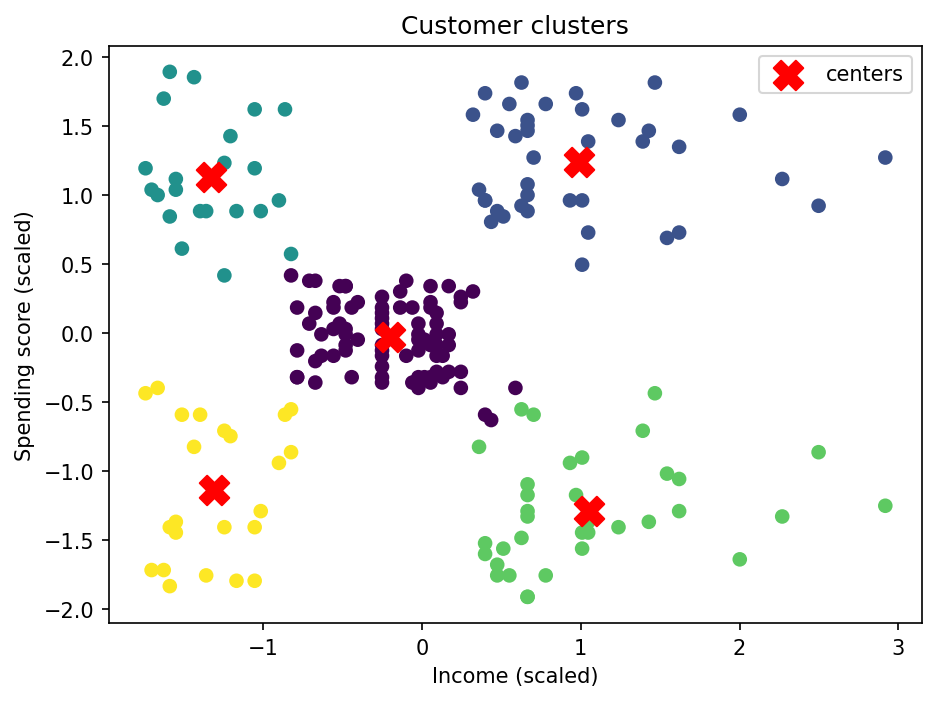
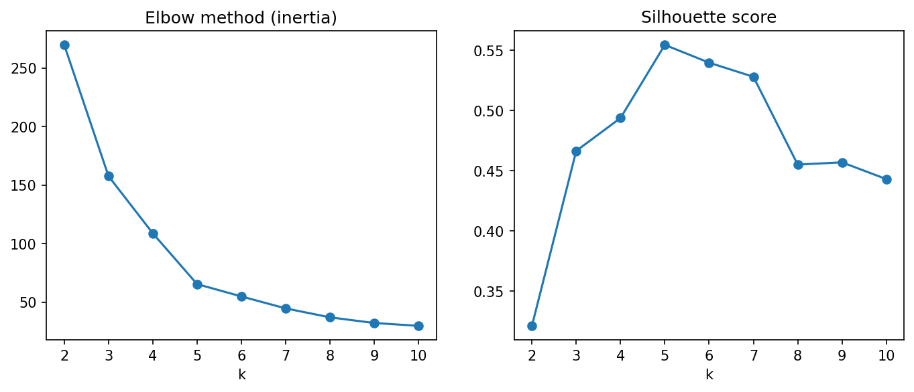
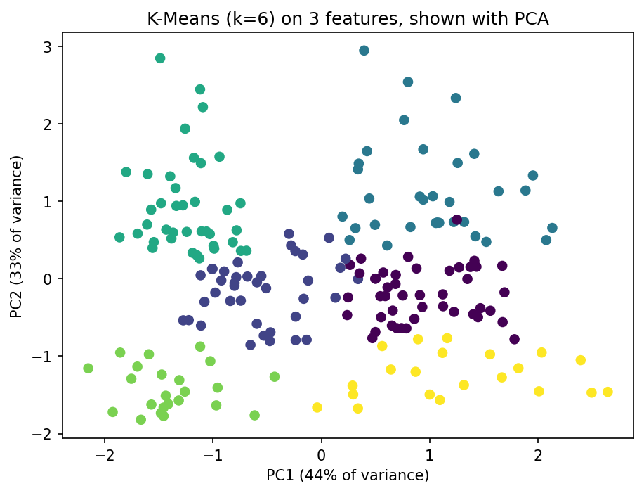
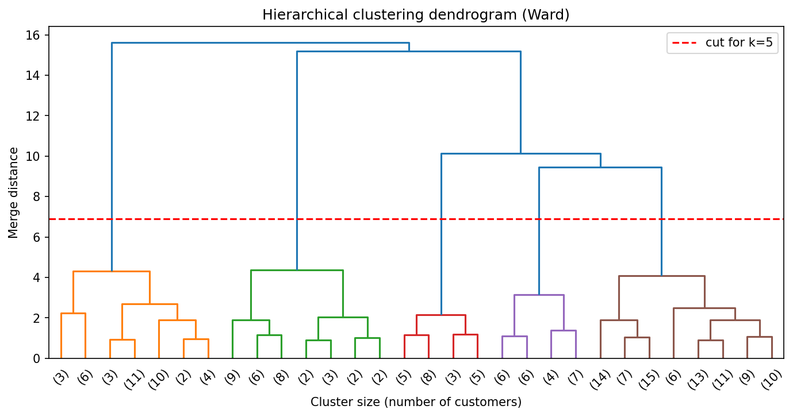

# Customer Segmentation with K-Means

Unsupervised machine learning project that groups 200 mall customers into meaningful segments using **K-Means clustering**, so a shop can adapt its marketing to each type of customer. The segmentation is then validated with **hierarchical clustering (Ward)**.

The project covers the full workflow: data checks, feature scaling, choosing the number of clusters (elbow, silhouette and stability), evaluation, cluster profiling, feature comparison, PCA visualization and a comparison with hierarchical clustering.

## Results at a glance

- **5 customer segments** found from annual income and spending score
- **Silhouette score:** 0.555 (reasonable separation)
- **Davies-Bouldin index:** 0.572 (low is good)
- **Stability (ARI):** 0.976 +/- 0.018 (the same groups are found on random subsamples)
- **Validation:** Ward hierarchical clustering finds the same 5 segments (ARI 0.942 with K-Means)



## Dataset

[Mall Customers dataset](https://www.kaggle.com/datasets/vjchoudhary7/customer-segmentation-tutorial-in-python) (Kaggle): 200 customers, no missing values, no duplicates.

| Column | Description |
|---|---|
| `CustomerID` | Unique identifier (not used) |
| `Genre` | Gender (not used) |
| `Age` | Age in years (used to describe the clusters) |
| `Annual Income (k$)` | Yearly income in thousands of dollars (**feature**) |
| `Spending Score (1-100)` | Score assigned by the mall (**feature**) |

Put `Mall_Customers.csv` in `data/raw/` before running the project.

## Method

1. **Data check:** shape, missing values, duplicates, summary statistics.
2. **Feature selection and scaling:** `Annual Income` and `Spending Score`, standardized with `StandardScaler` so both features count equally in the distance.
3. **Choosing k:** K-Means (with k-means++ initialization, `n_init=10`) was run for k = 2 to 10 and compared using three tools:
   - **Elbow method** (inertia)
   - **Silhouette score**
   - **Stability:** K-Means is fitted on two random 80% subsamples, both models label all customers, and the agreement is measured with the Adjusted Rand Index. This is repeated 20 times.
4. **Evaluation:** silhouette, Davies-Bouldin and Calinski-Harabasz scores.
5. **Profiling:** the average income, spending score and age of each cluster, so each group can be named and interpreted.
6. **Validation:** the same data is clustered with Ward hierarchical clustering and compared with K-Means.

## Choosing k

| k | Inertia | Silhouette | Stability |
|---|---|---|---|
| 2 | 269.7 | 0.321 | 0.224 |
| 3 | 157.7 | 0.467 | 1.000 |
| 4 | 108.9 | 0.494 | 0.775 |
| **5** | **65.6** | **0.555** | **0.976** |
| 6 | 55.1 | 0.540 | 0.924 |
| 7 | 44.9 | 0.528 | 0.881 |
| 8 | 37.2 | 0.455 | 0.821 |
| 9 | 32.4 | 0.457 | 0.803 |
| 10 | 30.0 | 0.443 | 0.750 |

**k = 5** was chosen because the three tools agree: the elbow bends at 5, the silhouette is highest at 5, and the clusters are very stable (0.976).



## Customer segments

| Cluster | Avg. income (k$) | Avg. spending | Avg. age | Size | Segment | Suggested action |
|---|---|---|---|---|---|---|
| 0 | 55.3 | 49.5 | 42.7 | 81 | Mainstream customers | Regular promotions and loyalty points |
| 1 | 86.5 | 82.1 | 32.7 | 39 | Best customers | VIP program, early access to new products |
| 2 | 25.7 | 79.4 | 25.3 | 22 | Young enthusiasts | Trendy products, social media campaigns |
| 3 | 88.2 | 17.1 | 41.1 | 35 | Wealthy but careful | Premium products and personalized offers (largest untapped potential) |
| 4 | 26.3 | 20.9 | 45.2 | 23 | Budget-conscious | Discounts and value bundles |

Cluster numbers are arbitrary and can change between runs. The segment names are an interpretation of each group's averages.

## Experiments

### Which features give the best clusters?

| Features | Best k | Silhouette | Davies-Bouldin |
|---|---|---|---|
| **Income + spending** | **5** | **0.555** | **0.572** |
| Income + spending + age | 6 | 0.428 | 0.825 |
| Age + spending | 2 | 0.472 | 0.845 |

Adding age made the clusters less separated, so the final model uses income and spending only. Age is used afterwards to describe the segments.

### PCA visualization (3 features)

To see the 3-feature clustering in 2D, PCA keeps 77.6% of the variance (PC1: 44.3%, PC2: 33.3%). PC2 is almost exactly income, and PC1 contrasts age with spending score. The plot shows that age only splits the middle group in a fuzzy way, which confirms the choice above.



### Hierarchical clustering (Ward)

To check that the segments are not an artifact of K-Means, the same scaled features (income and spending) were clustered with **agglomerative (bottom-up) hierarchical clustering**. Every customer starts alone, and at each step the two closest clusters are merged, until one cluster remains. Distances between points are Euclidean, and **Ward linkage** merges the pair of clusters that increases the total within-cluster variance the least:

$$\Delta(A, B) = \frac{|A|\,|B|}{|A| + |B|}\,\lVert \mu_A - \mu_B \rVert^2$$

The full merge history is stored in a linkage matrix `Z` (199 rows for 200 customers), which is drawn as a dendrogram and then cut to get the clusters.

**Choosing k.** Merging is cheap up to 5 clusters, then the merge height jumps, which means real groups would be forced together. The cut line is placed in the longest gap (about 6.9).

| Merge | Height |
|---|---|
| 6 to 5 clusters | 4.35 |
| 5 to 4 clusters | **9.45** |
| 4 to 3 clusters | 10.14 |
| 3 to 2 clusters | 15.19 |
| 2 to 1 cluster | 15.62 |

The silhouette of each cut agrees: it peaks at k = 5.

| k | 2 | 3 | 4 | **5** | 6 | 7 | 8 | 9 | 10 |
|---|---|---|---|---|---|---|---|---|---|
| Silhouette | 0.384 | 0.461 | 0.493 | **0.554** | 0.539 | 0.520 | 0.431 | 0.438 | 0.434 |

**Comparison with K-Means (k = 5).**

| | K-Means | Hierarchical (Ward) |
|---|---|---|
| Silhouette | 0.555 | 0.554 |
| Davies-Bouldin | 0.572 | 0.578 |
| Mainstream customers | 81 | 85 |
| Best customers | 39 | 39 |
| Young enthusiasts | 22 | 21 |
| Wealthy but careful | 35 | 32 |
| Budget-conscious | 23 | 23 |

The Adjusted Rand Index between the two clusterings is **0.942**: they agree on 196 of 200 customers. The 4 customers that differ are border cases from the mainstream group, which K-Means places in neighboring segments. K-Means stays the final model because it is simpler, faster on larger data and can assign new customers with `predict`.



The dendrogram shows only the last 30 merges for readability. The numbers in parentheses are the number of customers in each branch.

## Project structure

```
Mall_Customers/
├── data/
│   ├── raw/                    # Mall_Customers.csv (input)
│   └── processed/              # clustered_customers.csv (output)
├── reports/
│   ├── figures/                # saved plots
│   ├── cluster_profile.csv     # average of each feature per cluster
│   ├── hierarchical_profile.csv# same table for the hierarchical clusters
│   ├── k_selection.csv         # inertia, silhouette, stability for each k
│   └── metrics.json            # final metrics
├── mall_customers/
│   ├── config.py               # paths and settings
│   ├── dataset.py              # load and check data
│   ├── features.py             # select and scale features
│   ├── plots.py                # plots (including the dendrogram)
│   └── modeling/
│       ├── train.py            # try k values, train K-Means
│       ├── evaluate.py         # metrics, profiling, stability
│       └── hierarchical.py     # linkage tree and cut
├── main.py                     # runs the full K-Means pipeline
├── compare_features.py         # feature set comparison
├── pca_demo.py                 # PCA visualization
├── hierarchical_demo.py        # hierarchical clustering and comparison
└── requirements.txt
```

## How to run

```bash
git clone https://github.com/mohammedseghiralaa/mall-customers.git
cd mall-customers

python -m venv .venv
source .venv/bin/activate        # Windows: .venv\Scripts\activate
pip install -r requirements.txt

# put Mall_Customers.csv in data/raw/ then:
python main.py                   # full pipeline
python compare_features.py       # feature comparison
python pca_demo.py               # PCA plot
python hierarchical_demo.py      # hierarchical clustering
```

Close each plot window to let the script continue. Results are saved in `reports/` and `data/processed/`.

## Limitations and next steps

- Only 200 customers: results are less certain than with a large dataset.
- K-Means assumes round clusters of similar size and is sensitive to outliers.
- Hierarchical clustering needs all pairwise distances, so it is slow and memory-heavy on large datasets.
- Next steps: compare with DBSCAN and Gaussian Mixture Models, and try the same pipeline on a larger retail dataset (for example using RFM features).

## Tools

Python, pandas, NumPy, scikit-learn, SciPy, matplotlib.
